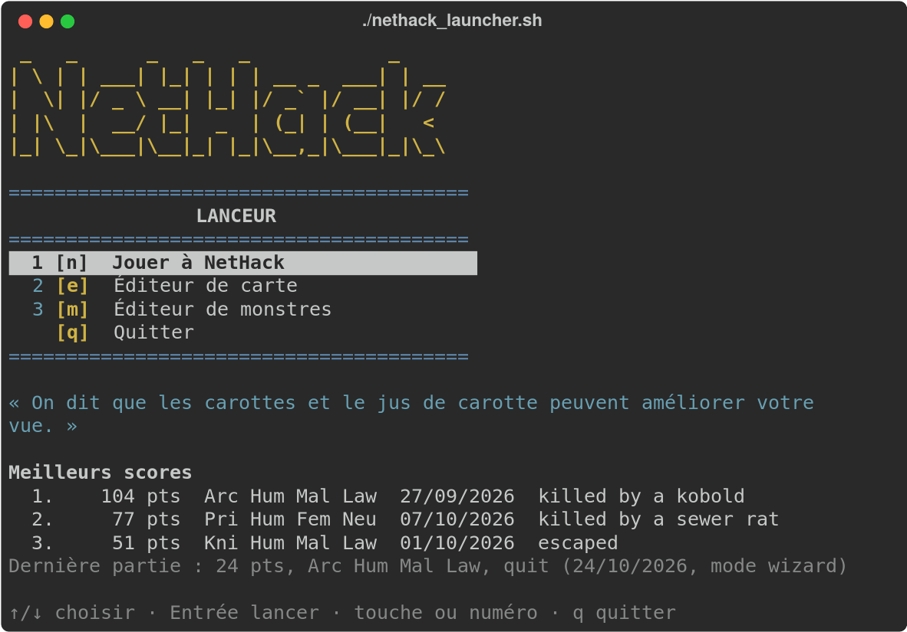

# NetHack Launcher

Petit lanceur en Python qui affiche un menu en terminal pour démarrer :

1. **NetHack** — `~/nh/install/games/nethack`
2. **L'éditeur de carte** — `~/JEUX/NETHACK/NetHack_MapEditor/nhmapedit.sh`



## Prérequis

- Python 3.9 ou plus récent
- Les deux programmes ci-dessus installés et exécutables

## Utilisation

```sh
./nethack_launcher.py
```

ou

```sh
python3 nethack_launcher.py
```

ou, depuis n'importe quel dossier (y compris via un lien symbolique, par exemple dans `~/bin`) :

```sh
./nethack_launcher.sh
```

Le menu s'affiche en plein écran :

- `↑` / `↓` pour choisir une entrée, `Entrée` pour la lancer (la ligne « Quitter » est aussi accessible aux flèches) ;
- ou directement le numéro de l'entrée ou sa touche (`n` pour NetHack, `e` pour l'éditeur) ;
- `q` ou `Échap` pour quitter.

Quand le programme lancé se termine, appuyez sur Entrée pour revenir au menu.

L'option `--texte` affiche à la place un menu simple, où l'on tape son choix puis Entrée. Ce menu est aussi utilisé automatiquement si l'entrée ou la sortie n'est pas un terminal.

Sous le menu sont affichés une rumeur de NetHack tirée au hasard (celles des fortune cookies), les meilleurs scores et un résumé de la dernière partie, lus dans le journal des parties de NetHack (`xlogfile`). Les parties en mode wizard ou exploration ne comptent pas dans les meilleurs scores.

Si le programme d'une entrée n'existe pas ou n'est pas exécutable, le menu l'indique à côté de son libellé, par exemple `(introuvable)`.

Le menu est affiché en couleurs dans un terminal. Elles sont désactivées automatiquement si la sortie n'est pas un terminal, si la variable d'environnement `NO_COLOR` est définie ou si `TERM=dumb`, ou à la demande avec l'option `--sans-couleur`.

### Lancement direct, sans menu

Indiquez l'entrée voulue, par son numéro, sa touche ou le nom de sa section dans `config.ini` :

```sh
./nethack_launcher.sh 1          # première entrée du menu
./nethack_launcher.sh e          # entrée de touche « e »
./nethack_launcher.sh nethack    # section [nethack]
./nethack_launcher.sh --liste    # affiche les entrées disponibles
```

Les arguments placés après l'entrée sont transmis au programme, après ceux de `config.ini` :

```sh
./nethack_launcher.sh nethack -u MonPerso
```

Le lanceur se termine alors avec le code de sortie du programme lancé.

## Configuration

Les chemins des programmes sont définis dans `config.ini`, à côté du script. Chaque section correspond à une entrée du menu, affichée dans l'ordre du fichier :

```ini
[nethack]
libelle = Jouer à NetHack
chemin = ~/nh/install/games/nethack
touche = n

[editeur]
libelle = Éditeur de carte
chemin = ~/JEUX/NETHACK/NetHack_MapEditor/nhmapedit.sh
touche = e
```

- `libelle` : texte affiché dans le menu (facultatif, le nom de la section est utilisé par défaut)
- `chemin` : programme à lancer ; `~` et les variables d'environnement (`$HOME`…) sont acceptés
- `arguments` : options passées au programme (facultatif). Les guillemets permettent d'inclure des espaces : `arguments = -u "Mon Perso" -p Valkyrie`
- `touche` : raccourci clavier pour choisir l'entrée dans le menu (facultatif). Une seule lettre, différente pour chaque entrée ; `q` est réservée pour quitter

Pour ajouter une entrée au menu, il suffit d'ajouter une nouvelle section. Par exemple, pour lancer directement un personnage précis ou le mode exploration :

```ini
[valkyrie]
libelle = NetHack - Valkyrie
chemin = ~/nh/install/games/nethack
arguments = -u Brunehilde -p Valkyrie
touche = v

[exploration]
libelle = NetHack - Mode exploration
chemin = ~/nh/install/games/nethack
arguments = -X
```

### Options du lanceur

La section `[options]` est réservée : ce n'est pas une entrée du menu.

```ini
[options]
dossier_nethack = ~/nh/install/games/lib/nethackdir
nombre_scores = 3
rumeur = oui
```

- `dossier_nethack` : dossier de données de NetHack (le `HACKDIR` défini dans le script `nethack`), où se trouve le fichier `xlogfile`. Laissez la valeur vide pour ne pas afficher les scores
- `nombre_scores` : nombre de meilleurs scores affichés (`0` pour aucun)
- `rumeur` : affiche une rumeur au hasard (`oui` ou `non`)
- `fichier_rumeurs` : fichier des rumeurs à utiliser (facultatif). Par défaut, le lanceur prend `rumors`, ou à défaut `rumors.<langue>` (par exemple `rumors.fr`), dans `dossier_nethack`

## Licence

Distribué sous licence MIT. Voir le fichier [LICENSE](LICENSE).
